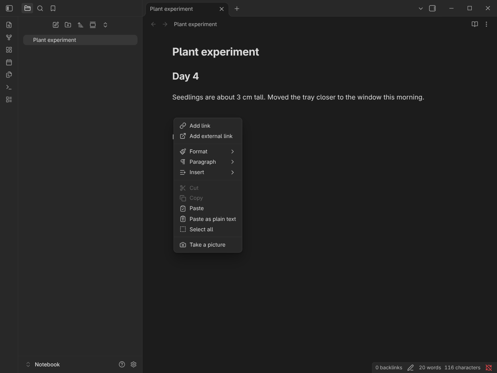
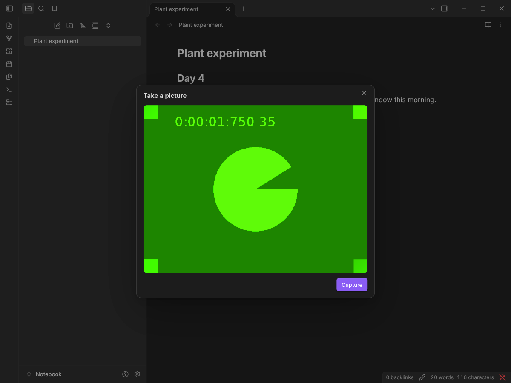
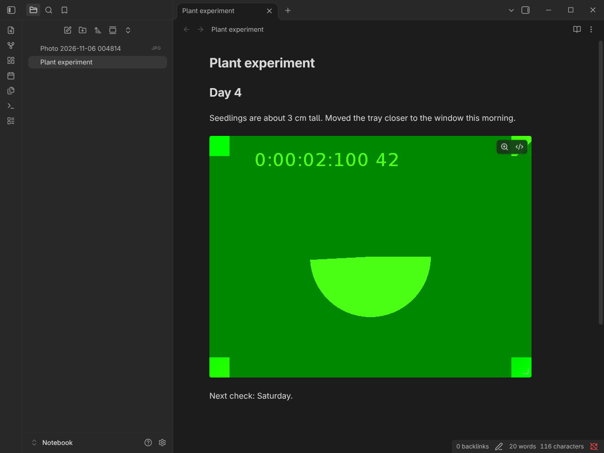

# Camera Capture for Obsidian

[](https://github.com/becutandavid/obsidian-camera-capture/releases/latest)
[](https://github.com/becutandavid/obsidian-camera-capture/actions/workflows/ci.yml)
[](LICENSE)

Take a photo without leaving your note. Right-click where the photo should go, choose **Take a picture**, and Camera Capture saves the photo to your vault and embeds it at the cursor.



## Features

- **Right where you are.** The photo is embedded at the exact cursor position where you opened the menu, mid-line included. Selected text is left alone.
- **Review before inserting.** On desktop you get a live preview, then **Capture**, then **Retake** or **Insert**.
- **Uses your phone's camera app on mobile.** Android and iOS open the system camera, so you get its focus, flash and lens controls.
- **Follows your vault settings.** Photos go to your *Default location for new attachments*, and links use your wikilink or Markdown preference, the same as pasted images.
- **Optional photo folder.** Send all photos to one folder instead. It's created if it doesn't exist.
- **Never overwrites.** Two photos taken in the same second get distinct names.
- **Private by design.** No network, no telemetry. The camera is only on while the capture window is open. See [Privacy](#privacy).

<p align="center">
  
  
</p>

## How to use

1. Put the cursor where the photo should go and **right-click** (or long-press on mobile).
2. Choose **Take a picture**.
3. **Desktop:** frame the shot and click **Capture**. Then **Insert**, or **Retake** to try again. Press Esc to cancel.
   **Mobile:** take the photo in your camera app and confirm it.

The photo is saved as `Photo YYYY-MM-DD HHmmss.jpg` and embedded as `![[Photo 2026-11-05 093012.jpg]]` (or `` with Markdown links).

**Tip:** the command **Camera Capture: Take a picture** does the same thing. Assign it a hotkey in *Settings → Hotkeys*, or add it to the mobile toolbar in *Settings → Mobile*.

## Settings

| Setting | Default | What it does |
|---|---|---|
| **Photo folder** | *(empty)* | Folder for new photos. Leave it empty to use Obsidian's *Settings → Files and links → Default location for new attachments*. |
| **JPEG quality** | 0.9 | Compression for desktop webcam photos, from 0.5 (smaller files) to 1 (best quality). Phone photos are saved exactly as your camera app made them. |

## Installation

### From Community plugins

Once the plugin is in the directory: open *Settings → Community plugins → Browse*, search for **Camera Capture**, then select **Install** and **Enable**.

### With BRAT (beta)

1. Install [BRAT](https://github.com/TfTHacker/obsidian42-brat) from Community plugins.
2. Run **BRAT: Add a beta plugin for testing** and enter `becutandavid/obsidian-camera-capture`.
3. Enable **Camera Capture** in *Settings → Community plugins*.

### Manually

1. Download `main.js`, `manifest.json` and `styles.css` from the [latest release](https://github.com/becutandavid/obsidian-camera-capture/releases/latest).
2. Put them in `<your vault>/.obsidian/plugins/camera-capture/`.
3. Reload Obsidian and enable **Camera Capture** in *Settings → Community plugins*.

## Compatibility

- Obsidian **1.5.7** or later.
- Desktop: Windows, macOS and Linux. Mobile: Android and iOS / iPadOS.
- On desktop, the system's default camera is used.

## Privacy

Camera Capture makes **no network requests** and collects **no telemetry**.

- **Desktop:** the webcam is turned on when the capture window opens. It turns off as soon as the window closes, whether you insert, cancel or press Esc.
- **Mobile:** the photo is taken by your device's own camera app and handed to Obsidian.
- **Storage:** photos are written only into your vault. Nothing is stored anywhere else.

## Troubleshooting

**"Camera access denied"**: Obsidian needs permission to use the camera.
- **macOS:** *System Settings → Privacy & Security → Camera*, turn on **Obsidian**, then restart Obsidian.
- **Windows:** *Settings → Privacy & security → Camera*, turn on **Let desktop apps access your camera**.
- **Android / iOS:** allow camera access for Obsidian in your system settings.

**"No camera found" on Linux with the Flatpak:** the Obsidian Flatpak can't see webcams by default. Allow it once with

```sh
flatpak override --user --device=all md.obsidian.Obsidian
```

then restart Obsidian.

**"Camera is in use by another app"**: close the other app (video calls, browser tabs) and try again.

**The photo is black:** check for a lens cover or privacy shutter, and make sure there's enough light. A dark photo also comes out dark straight from the camera.

**"Photo saved to …. The note changed during capture, so it wasn't inserted."**: you switched notes, or the note changed, while the camera was open. The photo is safe in your vault. Drag it into the note, or type ` and include your platform and Obsidian version.

## Contributing

Bug reports and pull requests are welcome. See [CONTRIBUTING.md](CONTRIBUTING.md) for the development setup, tests and the release process.

## License

[MIT](LICENSE) © David Galevski
